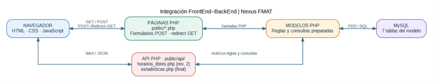
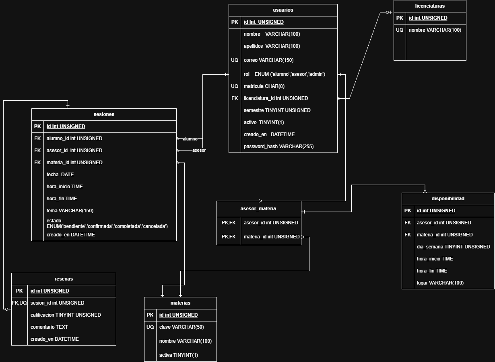

# NEXUS FMAT

**Sistema de gestión de asesorías académicas**

**Equipo:**

- Castillo Machado Oswaldo
- Dzul Celis César Alejandro
- Parra Canche Paola Lizzeth
- Villanueva Valdivia Luis Adrián

**Materia:** Desarrollo de Aplicaciones Web

**Fecha:** 28/10/2026

---

## 1. Descripción del problema

Muchos estudiantes tienen dificultades en varias materias y requieren de asesorías para mejorar su aprendizaje. Sin embargo, la organización de estas sesiones suele realizarse de una manera informal, lo que puede ocasionar problemas como choques de horarios, falta de registros de las sesiones, poca retroalimentación y desconocimiento por parte de la facultad sobre las materias en las que los alumnos necesitan más apoyo.

Por ello, se propone desarrollar un sistema web que facilite la organización, el registro y la evaluación de las asesorías académicas.

## 2. Objetivo y alcance

### Objetivo

Gestionar eficientemente las sesiones de asesorías de la facultad mediante un sistema web que permita consultar horarios disponibles, reservar sesiones, registrar su realización y evaluar la calidad de las asesorías recibidas.

### Dentro del alcance

El sistema permitirá:

- Consultar las materias en las que se ofrecen asesorías.
- Publicar y consultar los horarios disponibles de los asesores.
- Reservar asesorías considerando la disponibilidad del alumno y del asesor.
- Registrar las sesiones realizadas.
- Evaluar las asesorías mediante una calificación y comentarios.
- Consultar estadísticas sobre las materias más solicitadas y las calificaciones recibidas.

### Fuera del alcance

El sistema no incluirá videollamadas, pagos en línea ni notificaciones por correo electrónico. La asesoría se realizará fuera de la plataforma, de manera presencial o por los medios que acuerden los participantes.

## 3. Usuarios y roles

| Rol | Permisos |
|---|---|
| **Visitante** | Consultar información general del sistema. Ver las materias disponibles y conocer el funcionamiento de las asesorías. Registrarse para obtener una cuenta de alumno. |
| **Alumno** | Consultar los horarios disponibles de los asesores. Reservar y cancelar asesorías. Consultar sus próximas sesiones y su historial de asesorías. Registrar una calificación y comentarios sobre las sesiones completadas. |
| **Asesor** | Registrar y actualizar su disponibilidad de horarios. Consultar las solicitudes de asesoría recibidas. Confirmar o cancelar solicitudes y gestionar las sesiones programadas. Marcar como completadas las sesiones realizadas. |
| **Administrador** | Gestionar las cuentas de alumnos y asesores. Administrar las materias disponibles en el sistema. Supervisar las asesorías programadas y los registros de las sesiones. Consultar estadísticas sobre las materias más solicitadas y las calificaciones de las asesorías. Mantener actualizada la información general de la plataforma. |

## 4. Funcionalidad principal y requisitos funcionales

El flujo principal del sistema será: publicar disponibilidad → buscar asesoría → agendar sesión → realizar asesoría → calificar sesión → consultar estadísticas.

### Requisitos funcionales

#### RF-01. Crear cuenta de alumno

*Rol: Visitante | Operación: Crear | Revisión: Revisión 1*

El sistema deberá permitir el registro de una cuenta de alumno con nombre, apellidos, correo institucional, contraseña, matrícula, licenciatura y semestre. El correo y la matrícula deberán ser únicos, y el correo deberá cumplir con el dominio institucional configurado. El rol de asesor o administrador será asignado por una cuenta autorizada, no por el usuario durante el registro público.

#### RF-02. Iniciar sesión

*Rol: Alumno, asesor y administrador | Operación: Autenticación | Revisión: Revisión 1*

El sistema deberá validar las credenciales de los usuarios activos y mostrar las funciones correspondientes a su rol. Los mensajes de error no deberán revelar si una cuenta específica existe.

#### RF-03. Cerrar sesión

*Rol: Alumno, asesor y administrador | Operación: Cerrar sesión | Revisión: Revisión 1*

El sistema deberá cerrar la sesión autenticada, invalidar sus datos en el servidor y evitar que se pueda reutilizar la sesión cerrada para acceder a páginas protegidas.

#### RF-04. Consultar materias

*Rol: Visitante y alumno | Operación: Leer | Revisión: Revisión 1*

El sistema deberá mostrar las materias activas que cuentan con información disponible para asesorías.

#### RF-05. Consultar la tabla de horarios

*Rol: Alumno | Operación: Leer | Revisión: Revisión 1*

El sistema deberá presentar una tabla semanal de lunes a sábado, con intervalos de 30 minutos entre las 07:00 y las 21:00. Los indicadores del ejemplo significan:

- **Disponible:** el asesor publicó el bloque y aún puede reservarse.
- **Ocupado:** hay una sesión confirmada en ese intervalo.
- **Reservado:** existe una solicitud pendiente de confirmación.
- **—:** no se registró un bloque de disponibilidad para ese intervalo y no puede reservarse.

La tabla es informativa; la reserva deberá validarse nuevamente en el servidor.

| Horario | Lunes | Martes | Miércoles | Jueves | Viernes | Sábado |
|---|---|---|---|---|---|---|
| 07:00–07:30 | Disponible | Ocupado | Disponible | — | Disponible | — |
| 07:30–08:00 | Disponible | Ocupado | Disponible | — | Disponible | — |
| 08:00–08:30 | Reservado | Disponible | Disponible | Disponible | — | Disponible |
| 08:30–09:00 | Reservado | Disponible | — | Disponible | — | Disponible |
| … | … | … | … | … | … | … |
| 20:30–21:00 | Disponible | — | Ocupado | — | Disponible | — |

#### RF-06. Publicar disponibilidad

*Rol: Asesor | Operación: Crear, leer y actualizar | Revisión: Revisión 1*

El sistema deberá permitir que el asesor registre, consulte y modifique bloques semanales con materia, día, hora de inicio, hora de fin y lugar. El sistema validará el horario permitido y rechazará empalmes del mismo asesor.

#### RF-07. Crear materia

*Rol: Administrador | Operación: Crear | Revisión: Revisión 2*

El sistema deberá permitir al administrador registrar una materia con su clave y nombre. Ambos datos serán obligatorios, la clave deberá ser única y la información se validará antes de guardarse.

#### RF-08. Actualizar materia

*Rol: Administrador | Operación: Actualizar | Revisión: Revisión 2*

El sistema deberá permitir al administrador modificar la información de una materia existente sin alterar las sesiones históricas que la referencian.

#### RF-09. Desactivar materia

*Rol: Administrador | Operación: Eliminar lógico | Revisión: Revisión 2*

El sistema deberá permitir desactivar una materia que deje de ofrecerse, sin eliminar físicamente su registro ni la información histórica asociada.

#### RF-10. Administrar usuarios

*Rol: Administrador | Operación: Leer y actualizar; eliminar lógico | Revisión: Revisión 2*

El sistema deberá permitir consultar perfiles, actualizar datos autorizados, asignar roles y desactivar cuentas. La desactivación conservará las sesiones y reseñas históricas relacionadas; los permisos de administrador no podrán asignarse mediante el registro público.

#### RF-11. Buscar asesorías

*Rol: Alumno | Operación: Leer | Revisión: Revisión 2*

El sistema deberá permitir filtrar las opciones por materia, asesor, día y horario, mostrando únicamente bloques que puedan reservarse según las reglas de negocio.

#### RF-12. Agendar asesoría

*Rol: Alumno | Operación: Crear | Revisión: Revisión 2*

El sistema deberá permitir solicitar una sesión con asesor, materia, fecha, hora de inicio, hora de fin y tema. Antes de guardar, comprobará que la sesión quede dentro de un bloque del asesor y que no existan empalmes para el alumno ni para el asesor. La sesión se creará con estado pendiente.

#### RF-13. Gestionar solicitudes de asesoría

*Rol: Asesor | Operación: Leer y actualizar | Revisión: Revisión 2*

El sistema deberá permitir que el asesor consulte sus solicitudes y cambie su estado de pendiente a confirmada o cancelada. Las solicitudes y sus cambios de estado deberán conservarse en el historial.

#### RF-14. Cancelar una sesión

*Rol: Alumno que la reservó o asesor asignado | Operación: Actualizar estado | Revisión: Revisión 2*

El sistema deberá permitir cancelar una sesión mediante un cambio de estado, sin eliminar físicamente el registro. Las sesiones canceladas dejarán de bloquear el horario.

#### RF-15. Registrar sesión realizada

*Rol: Asesor | Operación: Actualizar estado | Revisión: Revisión 2*

El sistema deberá permitir marcar una sesión confirmada como completada únicamente cuando la asesoría se haya realizado.

#### RF-16. Registrar reseña

*Rol: Alumno que reservó la sesión | Operación: Crear | Revisión: Revisión 2*

El sistema deberá permitir registrar una sola reseña por sesión, únicamente cuando su estado sea completada. La calificación será un entero del 1 al 5 y el comentario será opcional.

#### RF-17. Consultar panel de estadísticas

*Rol: Administrador | Operación: Leer / generar indicadores | Revisión: Entrega final*

El sistema deberá mostrar la demanda de asesorías, sesiones completadas y canceladas, materias más solicitadas, calificación promedio, número de reseñas y asesorías por materia y periodo. Los indicadores se calcularán a partir de los registros almacenados.

## 5. Reglas de negocio

#### RN-01. Dominio y unicidad del correo

El correo de cada cuenta deberá ser único. El registro público de alumnos aceptará únicamente el dominio definido en la constante `DOMINIO_CORREO`, cuyo valor inicial será `alumnos.uady.mx`; si cambia el dominio institucional, se modificará la constante de configuración y no varias validaciones dispersas.

#### RN-02. Permisos según el rol

Cada usuario solo podrá ejecutar operaciones autorizadas para su rol. El rol de administrador no podrá asignarse mediante el formulario público de registro.

#### RN-03. Horario permitido

La disponibilidad y las sesiones deberán ubicarse de lunes a sábado, entre las 07:00 y las 21:00. Las horas de inicio y fin deberán alinearse con intervalos de 30 minutos; la hora de fin siempre será posterior a la hora de inicio.

#### RN-04. Empalme de disponibilidad

No se permitirán dos bloques que se empalmen para el mismo asesor en el mismo día. Dos intervalos se empalman cuando se cumplen simultáneamente las condiciones `inicio < otro_fin` y `fin > otro_inicio`. Por ejemplo, los bloques 10:00–11:00 y 11:00–12:00 no se empalman: el fin del primero es igual al inicio del segundo, por lo que la segunda condición no se cumple.

#### RN-05. Sesión dentro de un bloque

La sesión deberá quedar completamente dentro de un bloque de disponibilidad registrado para el mismo asesor, la misma materia y el día de la semana que corresponda a la fecha de la sesión. La hora de inicio de la sesión deberá ser mayor o igual al inicio del bloque y la hora de fin deberá ser menor o igual al fin del bloque.

#### RN-06. Empalme de sesiones

En una misma fecha, no podrá haber dos sesiones que se empalmen para el mismo asesor ni para el mismo alumno. Se aplicará la condición `inicio < otro_fin` y `fin > otro_inicio` al comparar los intervalos del mismo participante. Los estados pendiente y confirmada reservan el horario; las sesiones canceladas no lo bloquean. Los intervalos contiguos, como 10:00–11:00 y 11:00–12:00, no constituyen empalme.

#### RN-07. Estados permitidos de sesión

El campo de estado de una sesión solo podrá tomar los valores pendiente, confirmada, completada o cancelada. El sistema no utilizará los estados aceptada ni rechazada, ya que no forman parte del modelo de datos acordado.

#### RN-08. Reseñas válidas

Cada sesión completada podrá tener como máximo una reseña, asociada a su identificador de sesión. Solo el alumno que reservó la asesoría podrá registrarla y la calificación deberá ser un número entero del 1 al 5. Las sesiones pendientes, confirmadas o canceladas no podrán calificarse.

#### RN-09. Cancelación sin eliminación

Cancelar una sesión implica actualizar su estado a cancelada. El registro no se eliminará físicamente, para conservar el historial y permitir que las estadísticas reflejen las cancelaciones.

#### RN-10. Desactivación de usuarios y materias

Los usuarios y las materias que dejen de utilizarse se desactivarán en lugar de borrarse físicamente. La desactivación deberá conservar las sesiones y reseñas históricas vinculadas.

#### RN-11. Validación en el servidor

Las reglas de horario, empalme, permisos, estados y reseñas se deberán validar del lado del servidor antes de modificar la base de datos. Las validaciones del navegador serán únicamente una ayuda para el usuario.

## 6. Requisitos no funcionales

#### RNF-01. Protección de contraseñas

PHP deberá almacenar las contraseñas mediante `password_hash()` y comprobarlas con `password_verify()`. Nunca se guardarán contraseñas en texto plano.

#### RNF-02. Consultas preparadas

Las consultas a MySQL deberán utilizar consultas preparadas mediante PDO. No se concatenará directamente la entrada del usuario dentro de sentencias SQL.

#### RNF-03. Escape de salida

Los datos proporcionados por usuarios que se muestren en HTML deberán escaparse con `htmlspecialchars()` o una función adecuada al contexto para reducir el riesgo de inyección de contenido ejecutable.

#### RNF-04. Protección CSRF

Los formularios que creen, actualicen, desactiven o cancelen registros deberán incluir un token CSRF impredecible. El servidor verificará el token antes de ejecutar la operación.

#### RNF-05. Gestión segura de sesiones

El sistema deberá regenerar el identificador de sesión después de autenticar al usuario, configurar cookies con `HttpOnly` y `SameSite` y usar `Secure` cuando haya HTTPS. Las páginas y operaciones protegidas validarán la sesión y los permisos; al cerrar sesión se invalidará la sesión en el servidor.

#### RNF-06. Dominio institucional configurable

La validación del correo de alumnos utilizará la constante `DOMINIO_CORREO`, inicialmente `alumnos.uady.mx`, centralizando el cambio si la institución establece otro dominio.

#### RNF-07. Compatibilidad con navegadores

La aplicación deberá funcionar en las versiones estables más recientes de Google Chrome, Mozilla Firefox y Microsoft Edge disponibles al momento de realizar las pruebas.

#### RNF-08. Diseño responsivo

La interfaz deberá adaptarse a pantallas desde 360 píxeles de ancho sin pérdida de funciones ni desplazamiento horizontal innecesario. Las tablas podrán usar adaptación o desplazamiento horizontal controlado.

#### RNF-09. Idioma e integridad

La interfaz, etiquetas, validaciones y mensajes al usuario estarán en español. Las validaciones críticas se ejecutarán en el servidor, aunque también existan validaciones en el navegador.

## 7. Integración FrontEnd–BackEnd

El navegador presenta la interfaz desarrollada con HTML, CSS y JavaScript. Las operaciones tradicionales se enviarán mediante formularios POST a páginas PHP; al terminar, PHP redirigirá a una página GET (patrón POST–Redirect–GET) para evitar reenvíos accidentales al actualizar el navegador. A partir de la revisión 2 se incorporarán endpoints JSON dentro de `public/api/`, consumidos desde JavaScript con `fetch`.

Flujo de comunicación:

| Componente | Responsabilidad |
|---|---|
| Navegador (HTML/CSS/JS) | Muestra formularios, tabla de horarios y vistas. Envía GET/POST y usa `fetch` para solicitar JSON. |
| Páginas PHP en `public/` | Reciben formularios, validan sesión/rol y datos, invocan modelos y redirigen a GET después de operaciones POST. |
| API PHP en `public/api/` | Proporciona JSON para horarios libres (revisión 2) y estadísticas (entrega final), con autorización y validación. |
| Modelos PHP | Centralizan consultas a la base de datos y reglas que deban reutilizar páginas y endpoints; emplean consultas preparadas. |
| MySQL | Almacena la información en las siete tablas definidas en la sección 8. |

## 8. Base de datos

La base de datos se implementará en MySQL. La siguiente tabla resume el propósito de cada tabla y sus campos principales. Las relaciones, cardinalidades y restricciones completas se especifican en el diagrama entidad-relación (`docs/diagramas/diagrama_er.png`) y en el modelo relacional (`docs/requisitos/modelo_relacional.md`).

| Tabla | Campos, llaves y propósito |
|---|---|
| `licenciaturas` | `id` INT UNSIGNED (PK, AUTO_INCREMENT); `nombre` VARCHAR(100) (UNIQUE). Catálogo de licenciaturas; no contiene campo de activación. |
| `usuarios` | `id` (PK); `nombre`; `apellidos`; `correo` (UNIQUE); `password_hash`; `rol` ENUM('alumno', 'asesor', 'admin'); `matricula` CHAR(8) (UNIQUE); `licenciatura_id` (FK); `semestre` (1–9); `activo`; `creado_en`. `matricula`, `licenciatura_id` y `semestre` pueden ser NULL solo para el administrador; las cuentas de alumno y asesor requieren esos datos. |
| `materias` | `id` (PK); `clave` VARCHAR(50) (UNIQUE); `nombre` VARCHAR(100); `activa` TINYINT(1). Catálogo de materias; `activa` permite desactivar una materia sin borrar su registro. |
| `asesor_materia` | `asesor_id` y `materia_id` forman una PK compuesta y son FK a `usuarios.id` y `materias.id`. Relaciona a cada asesor con las materias que puede impartir; no tiene una columna `id` independiente. |
| `disponibilidad` | `id` (PK); `asesor_id`; `materia_id`; `dia_semana` (1–6); `hora_inicio`; `hora_fin`; `lugar`. La FK compuesta (`asesor_id`, `materia_id`) referencia `asesor_materia`, de modo que el asesor solo publica horarios para una materia que imparte. No incluye campo de activación. |
| `sesiones` | `id` (PK); `alumno_id` (FK a `usuarios.id`); `asesor_id` (FK a `usuarios.id`); `materia_id` (FK a `materias.id`); `fecha`; `hora_inicio`; `hora_fin`; `tema`; `estado` ENUM('pendiente', 'confirmada', 'completada', 'cancelada'); `creado_en`. `tema` es obligatorio. |
| `resenas` | `id` (PK); `sesion_id` (FK a `sesiones.id` y UNIQUE); `calificacion` TINYINT UNSIGNED (1–5); `comentario` (opcional); `creado_en`. La restricción UNIQUE en `sesion_id` permite como máximo una reseña por sesión. |

**Relaciones:** `usuarios.licenciatura_id` referencia `licenciaturas.id`; `asesor_materia` conecta `usuarios` y `materias` con PK compuesta (`asesor_id`, `materia_id`); `disponibilidad` referencia esa pareja; `sesiones` referencia `usuarios` mediante `alumno_id` y `asesor_id`, y `materias` mediante `materia_id`; `resenas.sesion_id` referencia `sesiones.id` y es UNIQUE. Las FK históricas usan RESTRICT; `disponibilidad` usa CASCADE desde `asesor_materia`.

## 9. Panel de estadísticas

El panel estará dirigido al administrador y servirá para conocer la demanda de asesorías y apoyar la planeación académica. Los indicadores se calcularán desde las tablas de sesiones, materias y reseñas.

| Indicador | Utilidad para la facultad |
|---|---|
| Asesorías solicitadas | Mide el volumen total de solicitudes registradas y la demanda general. |
| Sesiones completadas | Cuantifica las asesorías efectivamente realizadas. |
| Sesiones canceladas | Permite detectar cancelaciones y posibles dificultades de disponibilidad. |
| Materias más solicitadas | Identifica las asignaturas en las que los alumnos requieren más apoyo. |
| Calificación promedio y número de reseñas | Muestra la valoración de los alumnos y la cantidad de opiniones que la respaldan. |
| Asesorías por materia y periodo | Permite comparar la demanda a lo largo del tiempo y planificar horarios y recursos. |
